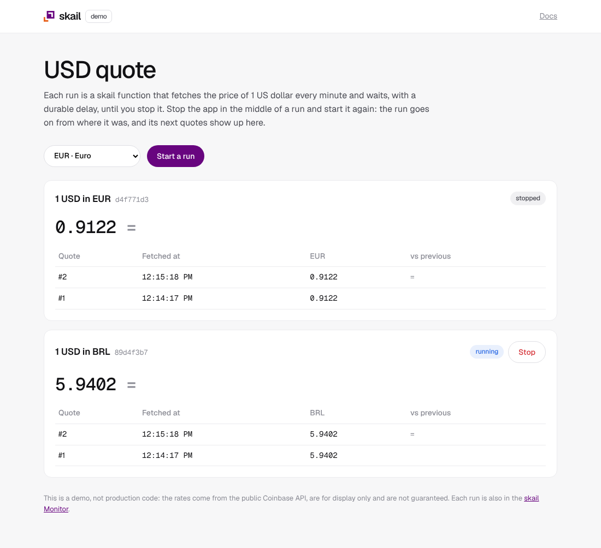

# skail USD quote (Node.js)

[Português (Brasil)](README.pt-BR.md)

An app with a skail function that fetches the US dollar quote, waits one minute with a durable delay and fetches again, until you stop it. You start and stop the runs on a page the app serves at http://localhost:8080.

It shows three skail features:

- a **durable delay**: close the app in the middle of a wait, start it again and the run goes on from where it was;
- an **external event** (`STOP_TRACKING`) that stops the run in the middle of a wait;
- **automatic retries**: when the quote API fails, skail tries again by itself.

## Requirements

- One of: [Docker](https://docs.docker.com/get-docker/), [Podman](https://podman.io/docs/installation) or [Node.js](https://nodejs.org) 20.12 or newer. The run script uses the first one it finds.
- A skail environment with a workload registered for the `SKAIL_WORKLOAD` in `.env` (`usdquote:v1.0.0` by default). The [Quickstart](https://docs.skail.dev/comece-aqui/quickstart) shows how to create the account, the environment and the workload.

The project uses `@skail/runtime` and `@skail/build` **2.0.1-rc4**.

## Run

```bash
cp .env.example .env  # fill in SKAIL_SIDECAR, SKAIL_NAMESPACE and SKAIL_KEY (portal > Environments & keys > Connect)
scripts/run.sh        # then open http://localhost:8080
```

On Windows, in PowerShell: `copy .env.example .env`, then `powershell -ExecutionPolicy Bypass -File scripts\run.ps1`. The script works on the Windows PowerShell built into Windows; PowerShell 7 is not needed.

The script runs the demo with what the machine has: Docker, then Podman, then Node.js. If it finds none of them, it says what to install. Without the script, the commands are `npm install`, `npm run build` and `npm start`.



| What you click | What happens |
|---|---|
| a currency (BRL, EUR, CNY or JPY), then **Start a run** | a new run fetches 1 USD in that currency now and then once a minute |
| **Stop** on a run | the app fires `STOP_TRACKING`; the run ends during the current wait |

Each quote shows when it was fetched and whether it went up (▲), down (▼) or stayed the same (=) since the previous one. You can run several currencies at once. The page refreshes itself every second, and each quote is also printed to the console.

## How it works

The app does three jobs in one process: it serves the page, it hosts the worker that runs the function (`createSkailPlatform`, with the bundle built by `npm run build`), and it starts and stops the runs through the skail HTTP API:

```http
POST {SKAIL_SIDECAR}/api/v1/trigger/usdquote/v1.0.0/TrackUsdQuote/{runId}
["{runId}", "BRL"]

POST {SKAIL_SIDECAR}/api/v1/fire/STOP_TRACKING/{runId}
{}
```

The function, in [`src/quote-functions.ts`](src/quote-functions.ts):

```ts
@SkailFunction({ retryCount: 0 })
async TrackUsdQuote(runId: string, currency: Currency): Promise<number> {
  const stopEvent = Skail.waitForEvent<unknown>(Events.stopTracking, runId);

  for (let quoteNumber = 1; ; quoteNumber++) {
    const quote = await this.FetchQuote(currency);
    await this.ReportQuote(runId, quoteNumber, quote);

    // whenAny returns the winning value: the stop event delivers its payload, the delay completes with undefined
    const winner = await Skail.whenAny([stopEvent, Skail.delaySeconds(INTERVAL_SECONDS)]);
    if (isStopSignal(winner)) {
      await this.ReportStopped(runId, quoteNumber);
      return quoteNumber;
    }
  }
}
```

- The function only orchestrates. Each time the run wakes up (after a delay, an event or an app restart), skail runs it again from the start (replay).
- The I/O lives in commands: `FetchQuote` calls the quote API, and `ReportQuote` and `ReportStopped` hand the result to the page. The commands run in an isolated VM, so `ReportQuote` and `ReportStopped` hand what the page shows to the app over HTTP, on its own port under `/internal/`. A command that completed is never run again, so a replay does not fetch again nor show the same quote twice.
- The wait for `STOP_TRACKING` is created once and reused in every `whenAny` against the one-minute delay: whichever comes first wins.

| File | What it has |
|---|---|
| `src/quote-functions.ts` | The function and its commands. |
| `src/quotes.ts` | The call to the Coinbase exchange rates. |
| `src/quote-desk.ts` | Starts and stops the runs for the page, and keeps the quotes each one reported. |
| `page/index.html` | The page, with the skail branding. |
| `src/skail-api.ts` | Trigger and fire through the skail HTTP API. |
| `src/main.ts` | Reads `.env`, serves the page and its API, and starts the worker. |
| `scripts/build-skail.mjs` | Builds the bundle into `.skail/` for `SKAIL_WORKLOAD`; run `npm run build` again if it changes. |
| `scripts/run.sh`, `scripts/run.ps1`, `Dockerfile` | Run the demo with Docker, Podman or Node.js, whatever the machine has. |

## See the durability

1. Run `scripts/run.sh`, open the page, start a run and wait for the first quote.
2. During the one-minute wait, press **Ctrl+C**. The app closes; the run stays in skail, waiting.
3. Run `scripts/run.sh` again and open the page. skail hands the app the run that was waiting: the next quote arrives on schedule, numbered after the last one, and the run shows up on the page with it. The quotes from before the restart were in the memory of the app that closed, so they are not on the page. Click **Stop** to end the run.

In the portal, open the [Monitor](https://docs.skail.dev/referencia/portal/monitor) of your environment and click the run: each quote shows up as `FetchQuote` and `ReportQuote`, each wait as a `whenAny` with its `Delay`, and the stop as `ReportStopped`.

## When the quote API fails

The quotes come from the public Coinbase exchange rates API, which needs no key. When it does not answer, or answers with an error (a `429` for too many requests, a `5xx`), `FetchQuote` throws, and skail retries it with a growing wait (15 s, 30 s, 1 min, 2 min, 4 min), up to 5 times (`@SkailCommand({ retryCount: 5 })`). The page waits meanwhile; in the Monitor, `FetchQuote` shows each attempt. If the API does not come back in time, the run ends as Failed in the Monitor (`retryCount: 0` on the function).

## Notes

- A run has no limit: it goes on until you stop it. Stop the runs you start, so they do not keep running in your environment.
- Apps running the same `SKAIL_WORKLOAD` on the same environment share the same runs: use one workload (or environment) per person.

## Disclaimer

**This is a demo, not production code.** It exists only to show how [skail](https://docs.skail.dev) works and is provided "as is", without warranty of any kind. It uses a free third-party API (the Coinbase exchange rates) that may change, limit or refuse requests at any time. The quotes are for display only: do not rely on them for any decision.

## License

[Apache-2.0](LICENSE)
