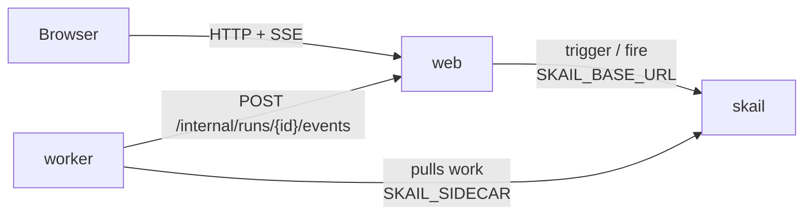

# skail USD quote (Node / TypeScript + React)

[Português (Brasil)](README.pt-BR.md)

A skail function fetches the US dollar quote, waits 30 seconds with a durable delay and fetches again. It keeps going until you press **Stop** or it reaches 20 quotes (about 10 minutes), and a React page shows each quote as it arrives.

The demo covers three topics of the [skail docs](https://docs.skail.dev) (in Portuguese):

- a [durable delay](https://docs.skail.dev/construa/conceitos/tempo-e-agendamento) that survives a worker restart;
- an [external event](https://docs.skail.dev/construa/conceitos/eventos-externos-e-correlacao) that stops the run in the middle of a wait;
- the [wait with a deadline](https://docs.skail.dev/construa/como-fazer/esperar-um-evento-com-prazo) pattern: the event or the delay, whichever comes first.

## How it works



- **worker** (`apps/worker`): the function `TrackUsdQuote(runId, currency)` and its commands. `FetchQuote` gets the quote; `ReportQuote`, `ReportStopped`, `ReportCompleted` and `ReportFailure` send the progress to the web app.
- **web** (`apps/web`): API and static files. It starts a run (trigger), stops it (fire), keeps the run state in memory and streams it to the page (SSE).
- **frontend** (`apps/frontend`): the page, in React 18, Vite and TypeScript.
- **contracts** (`apps/contracts`): types, constants and the Start/Stop rules shared by the other three. It also goes into the skail bundle, so it has no Node I/O imports.

The function only orchestrates and leaves the I/O to the commands. It creates one wait for `STOP_TRACKING` and reuses it in every `whenAny` against the 30-second delay. In TypeScript, `whenAny` returns the value of the winner, and a delay that wins returns `undefined` (see [SDKs and languages](https://docs.skail.dev/referencia/sdk-typescript-e-outras-linguagens)). Simplified from [`quote-functions.ts`](apps/worker/src/quote-functions.ts), which also reports a failed fetch to the page:

```ts
const stopEvent = Skail.waitForEvent<unknown>(Events.stopTracking, runId);

for (let quoteNumber = 1; quoteNumber <= QuoteLimits.maxQuotes; quoteNumber++) {
  const quote = await this.FetchQuote(currency);
  await this.ReportQuote(runId, quoteNumber, quote);
  if (quoteNumber === QuoteLimits.maxQuotes) break;

  const winner = await Skail.whenAny([stopEvent, Skail.delaySeconds(QuoteLimits.intervalSeconds)]);
  if (isStopSignal(winner)) {
    await this.ReportStopped(runId, quoteNumber);
    return { quoteCount: quoteNumber, end: "Stopped" };
  }
}
```

The page has a currency list (Real, Euro, Yuan, Yen; Real is the default), locked while a run is active, and a single button that toggles between **Start** and **Stop**.

## How it connects to skail

| Service | Variable | Used for |
|---|---|---|
| worker | `SKAIL_SIDECAR` | Connects the function to your environment and receives its work. |
| web | `SKAIL_BASE_URL` | Starts and stops runs through the skail HTTP API. |

Both use the same `SKAIL_WORKLOAD`, `SKAIL_NAMESPACE` and `SKAIL_KEY`. The web app makes two calls:

```http
POST {SKAIL_BASE_URL}/api/v1/trigger/{name}/{version}/TrackUsdQuote/{runId}
["{runId}", "{currency}"]

POST {SKAIL_BASE_URL}/api/v1/fire/STOP_TRACKING/{runId}
{}
```

`{name}` and `{version}` come from `SKAIL_WORKLOAD` (`name:version`). Each call sends the key in `skail-key` and in `Authorization: Bearer`, plus the `Skail-namespace` header, as described in [authentication](https://docs.skail.dev/referencia/api-http/autenticacao). `429`, `5xx` and network errors are retried with the same run id. `401` and `403` are not retried: check `SKAIL_KEY` and `SKAIL_NAMESPACE`.

The browser never calls skail. It only talks to the web app, so the key stays on the server.

## Requirements

- Node 20, 22 or 24 and pnpm 10 (`npm i -g pnpm@10.34.7`)
- podman or docker
- PowerShell 7+ (`pwsh`), only if you use `scripts/run.ps1` instead of `scripts/run.sh`
- A skail environment with the workload from `SKAIL_WORKLOAD` registered (`usdquote:v1.0.0` by default). The [Quickstart](https://docs.skail.dev/comece-aqui/quickstart) shows how to get an account, create the environment and register the workload.
- Access to the public npm registry, where `@skail/runtime`, `@skail/testing` (2.0.1-rc1) and `@skail/build` (2.0.0) come from.
- A current browser (Chrome/Edge 111+, Firefox 113+, Safari 16.2+). The page uses Server-Sent Events and CSS `color-mix()`.

## Configure

```bash
cp .env.example .env     # .env holds the key and is ignored by git
```

Fill in `SKAIL_WORKLOAD` (exactly as registered in the portal), `SKAIL_NAMESPACE`, `SKAIL_KEY`, `SKAIL_SIDECAR` and `SKAIL_BASE_URL` with the values of your environment.

The skail bundle cannot read environment variables, so the worker gets `SKAIL_WORKLOAD`, `WEB_BASE_URL` and `QUOTE_PROVIDER`/`QUOTE_API_URL` when it is built ([`gen-config.mjs`](apps/worker/scripts/gen-config.mjs)). After changing them in `.env`, build again; `scripts/run.sh up` does it.

## Run with podman or docker

```bash
scripts/run.sh up        # builds both images and starts web + worker
scripts/run.sh logs
scripts/run.sh down
```

`CONTAINER_ENGINE=docker` forces docker. On Windows, or anywhere with PowerShell 7+, run `pwsh scripts/run.ps1 <command>` with the same commands; `$env:CONTAINER_ENGINE = "docker"` forces docker.

Open <http://localhost:8080>, pick a currency and press **Start**.

### See the durability

1. Press **Start** and wait for the first quote.
2. During the 30-second wait, run `scripts/run.sh restart`. It restarts only the worker; the web app keeps the page state.
3. The next quote arrives on schedule, handled by the restarted worker.
4. Press **Stop** at any time, even in the middle of a wait. The function wakes up and ends without another fetch.

In the portal, open the [Monitor](https://docs.skail.dev/referencia/portal/monitor) of your environment and click the run. Each quote shows up as `FetchQuote` and `ReportQuote`, each wait as a `WhenAny` with its `Delay`, and the stop as `ReportStopped`. The `WaitForEvent` for `STOP_TRACKING` shows up once, at the top, because the function creates that wait at the start and reuses it.

Compare **Duration** with **E2E Duration**. In a run of 3 quotes, E2E Duration goes past one minute while Duration stays under one second, because the waits do not use the worker. A run you stop also shows as **Completed**, because the function returns normally; the result it returns says how it ended (`end: "Stopped"`).

## VS Code

Open the folder and accept the recommended extensions.

- `Ctrl+Shift+B` builds, the *test* task runs the tests and the `containers: up/down/logs` tasks call `scripts/run.sh`.
- The **Worker + Web** debug configuration starts both apps reading `.env`, and a breakpoint inside a command works. Its build task bakes `WEB_BASE_URL=http://localhost:8080` into the bundle, because outside containers the web app is on `localhost`.
- For the page with hot reload, run the `dev: front end (vite)` task. It forwards `/api` to the web app on port 8080.

## Tests

```bash
pnpm install
pnpm test
```

The unit tests cover the contracts, the quote providers, the progress notifier, the function in memory with `@skail/testing` (loop, 30-second delay, stop event, 20-quote limit, retries and failure), the `skail build` of the worker, the run state, the calls to skail (trigger, fire and retries), the web API with SSE and the React page. They need neither network nor skail.

## Notes

- `QUOTE_PROVIDER=fake` runs without internet, with simulated quotes. The default provider is AwesomeAPI, which may answer `429`; skail retries the command.
- Stop is idempotent: pressing it twice, or after the run ended, has no effect.
- The run history lives in skail. The page state lives in memory and is lost when the web app restarts.
- `POST /internal/runs/{id}/events`, which the worker calls to report progress, has no authentication. That is fine for a local demo; protect it before using the pattern in production.
- Workers running the same `SKAIL_WORKLOAD` on the same environment share the same runs: use one workload (or environment) per person.

## License

[Apache-2.0](LICENSE)
