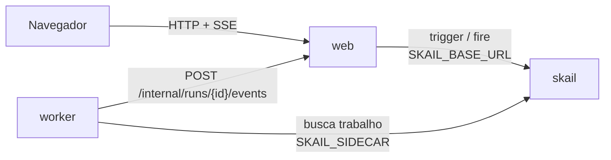

# skail USD quote (Node / TypeScript + React)

[English](README.md)

Uma function do skail consulta a cotação do dólar, espera 30 segundos com um delay durável e consulta de novo. Ela continua até você clicar em **Stop** ou chegar a 20 cotações (cerca de 10 minutos), e uma página React mostra cada cotação assim que ela chega.

A demo mostra três tópicos da [documentação do skail](https://docs.skail.dev):

- um [delay durável](https://docs.skail.dev/construa/conceitos/tempo-e-agendamento), que sobrevive ao reinício do worker;
- um [evento externo](https://docs.skail.dev/construa/conceitos/eventos-externos-e-correlacao), que para a execução no meio de uma espera;
- o padrão de [espera com prazo](https://docs.skail.dev/construa/como-fazer/esperar-um-evento-com-prazo): o evento ou o delay, o que vier primeiro.

## Como funciona



- **worker** (`apps/worker`): a function `TrackUsdQuote(runId, currency)` e os commands dela. O `FetchQuote` consulta a cotação, e `ReportQuote`, `ReportStopped`, `ReportCompleted` e `ReportFailure` mandam o andamento para o web.
- **web** (`apps/web`): API e arquivos estáticos. Inicia a execução (trigger), para a execução (fire), guarda o estado em memória e transmite para a página (SSE).
- **frontend** (`apps/frontend`): a página, em React 18, Vite e TypeScript.
- **contracts** (`apps/contracts`): tipos, constantes e as regras do botão Start/Stop, usados pelos outros três. Ele também entra no bundle do skail, por isso não importa módulos de I/O do Node.

A function só orquestra e deixa o I/O para os commands. Ela cria uma única espera por `STOP_TRACKING` e reaproveita essa espera em todos os `whenAny` contra o delay de 30 segundos. Em TypeScript, o `whenAny` devolve o valor de quem terminou primeiro, e um delay que vence devolve `undefined` (ver [SDKs e linguagens](https://docs.skail.dev/referencia/sdk-typescript-e-outras-linguagens)). O trecho abaixo é uma versão simplificada do [`quote-functions.ts`](apps/worker/src/quote-functions.ts), que também avisa a página quando a consulta falha:

```ts
const stopEvent = Skail.waitForEvent<unknown>(Events.stopTracking, runId);

for (let quoteNumber = 1; quoteNumber <= QuoteLimits.maxQuotes; quoteNumber++) {
  const quote = await this.FetchQuote(currency);
  await this.ReportQuote(runId, quoteNumber, quote);
  if (quoteNumber === QuoteLimits.maxQuotes) break;

  const winner = await Skail.whenAny([stopEvent, Skail.delaySeconds(QuoteLimits.intervalSeconds)]);
  if (isStopSignal(winner)) {
    await this.ReportStopped(runId, quoteNumber);
    return { quoteCount: quoteNumber, end: "Stopped" };
  }
}
```

A página tem uma lista de moedas (Real, Euro, Yuan e Iene, com Real como padrão), que fica bloqueada enquanto há uma execução ativa, e um único botão que alterna entre **Start** e **Stop**.

## Como conecta ao skail

| Serviço | Variável | Para quê |
|---|---|---|
| worker | `SKAIL_SIDECAR` | Conecta a function ao seu environment e recebe o trabalho dela. |
| web | `SKAIL_BASE_URL` | Inicia e para execuções pela API HTTP do skail. |

Os dois usam os mesmos `SKAIL_WORKLOAD`, `SKAIL_NAMESPACE` e `SKAIL_KEY`. O web faz duas chamadas:

```http
POST {SKAIL_BASE_URL}/api/v1/trigger/{nome}/{versao}/TrackUsdQuote/{runId}
["{runId}", "{currency}"]

POST {SKAIL_BASE_URL}/api/v1/fire/STOP_TRACKING/{runId}
{}
```

`{nome}` e `{versao}` vêm de `SKAIL_WORKLOAD` (`nome:versao`). Cada chamada manda a chave em `skail-key` e em `Authorization: Bearer`, mais o header `Skail-namespace`, como descrito em [autenticação](https://docs.skail.dev/referencia/api-http/autenticacao). `429`, `5xx` e erros de rede são repetidos com o mesmo run id. `401` e `403` não são repetidos: confira `SKAIL_KEY` e `SKAIL_NAMESPACE`.

O navegador nunca chama o skail. Ele só fala com o web, então a chave fica no servidor.

## Requisitos

- Node 20, 22 ou 24 e pnpm 10 (`npm i -g pnpm@10.34.7`)
- podman ou docker
- PowerShell 7+ (`pwsh`), só se você usar o `scripts/run.ps1` em vez do `scripts/run.sh`
- Um environment do skail com o workload de `SKAIL_WORKLOAD` cadastrado (`usdquote:v1.0.0` por padrão). O [Quickstart](https://docs.skail.dev/comece-aqui/quickstart) mostra como pedir a conta, criar o environment e cadastrar o workload.
- Acesso ao registro público do npm, de onde vêm `@skail/runtime`, `@skail/testing` (2.0.1-rc1) e `@skail/build` (2.0.0).
- Um navegador atual (Chrome/Edge 111+, Firefox 113+, Safari 16.2+). A página usa Server-Sent Events e `color-mix()` do CSS.

## Configurar

```bash
cp .env.example .env     # o .env guarda a chave e é ignorado pelo git
```

Preencha `SKAIL_WORKLOAD` (exatamente como está cadastrado no portal), `SKAIL_NAMESPACE`, `SKAIL_KEY`, `SKAIL_SIDECAR` e `SKAIL_BASE_URL` com os valores do seu environment.

O bundle do skail não lê variáveis de ambiente, então o worker recebe `SKAIL_WORKLOAD`, `WEB_BASE_URL` e `QUOTE_PROVIDER`/`QUOTE_API_URL` no build ([`gen-config.mjs`](apps/worker/scripts/gen-config.mjs)). Depois de mudar esses valores no `.env`, faça o build de novo; o `scripts/run.sh up` já faz isso.

## Rodar com podman ou docker

```bash
scripts/run.sh up        # builda as duas imagens e sobe web + worker
scripts/run.sh logs
scripts/run.sh down
```

`CONTAINER_ENGINE=docker` força o docker. No Windows, ou em qualquer sistema com PowerShell 7+, rode `pwsh scripts/run.ps1 <comando>` com os mesmos comandos; `$env:CONTAINER_ENGINE = "docker"` força o docker.

Abra <http://localhost:8080>, escolha a moeda e clique em **Start**.

### Ver a durabilidade

1. Clique em **Start** e espere a primeira cotação.
2. Durante a espera de 30 segundos, rode `scripts/run.sh restart`. Ele reinicia só o worker, e o web mantém o estado da página.
3. A próxima cotação chega no horário, processada pelo worker reiniciado.
4. Clique em **Stop** a qualquer momento, até no meio de uma espera. A function acorda e termina sem fazer outra consulta.

No portal, abra o [Monitor](https://docs.skail.dev/referencia/portal/monitor) do seu environment e clique na execução. Cada cotação aparece como `FetchQuote` e `ReportQuote`, cada espera como um `WhenAny` com o seu `Delay`, e o Stop como `ReportStopped`. O `WaitForEvent` do `STOP_TRACKING` aparece uma vez só, no topo, porque a function cria essa espera no início e reaproveita.

Compare **Duration** com **E2E Duration**. Numa execução de 3 cotações, o E2E Duration passa de um minuto e o Duration fica abaixo de um segundo, porque as esperas não ocupam o worker. Uma execução parada também aparece como **Completed**, porque a function retorna normalmente; o resultado que ela devolve diz como terminou (`end: "Stopped"`).

## VS Code

Abra a pasta e aceite as extensões recomendadas.

- `Ctrl+Shift+B` compila, a task *test* roda os testes e as tasks `containers: up/down/logs` chamam o `scripts/run.sh`.
- A configuração de debug **Worker + Web** sobe os dois apps lendo o `.env`, e um breakpoint dentro de um command funciona. A task de build dela grava `WEB_BASE_URL=http://localhost:8080` no bundle, porque fora de container o web fica em `localhost`.
- Para a página com hot reload, rode a task `dev: front end (vite)`. Ela repassa `/api` para o web na porta 8080.

## Testes

```bash
pnpm install
pnpm test
```

Os testes unitários cobrem os contratos, os providers de cotação, o notificador de progresso, a function em memória com `@skail/testing` (laço, delay de 30 segundos, evento de parada, limite de 20 cotações, novas tentativas e falha), o `skail build` do worker, o estado das execuções, as chamadas ao skail (trigger, fire e novas tentativas), a API web com SSE e a página React. Eles não precisam de rede nem do skail.

## Observações

- `QUOTE_PROVIDER=fake` roda sem internet, com cotações simuladas. O provider padrão é a AwesomeAPI, que pode responder `429`; nesse caso o skail repete o command.
- O Stop é idempotente: clicar duas vezes, ou depois que a execução terminou, não tem efeito.
- O histórico da execução fica no skail. O estado da página fica em memória e se perde quando o web reinicia.
- O `POST /internal/runs/{id}/events`, que o worker chama para avisar o progresso, não tem autenticação. Para uma demo local isso basta; proteja esse endpoint antes de usar o padrão em produção.
- Workers com o mesmo `SKAIL_WORKLOAD` no mesmo environment dividem as mesmas execuções: use um workload (ou environment) por pessoa.

## Licença

[Apache-2.0](LICENSE)
